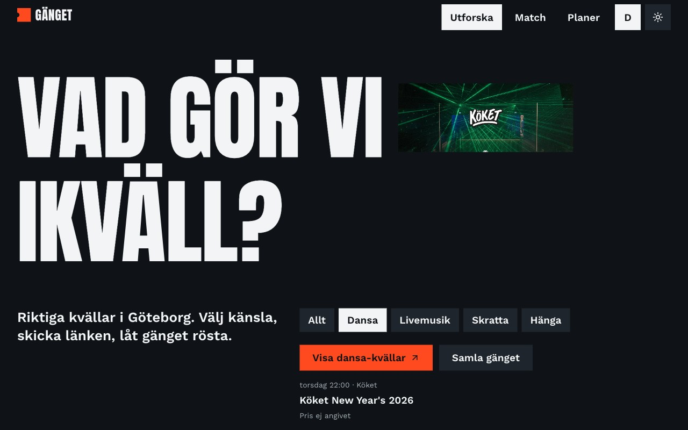
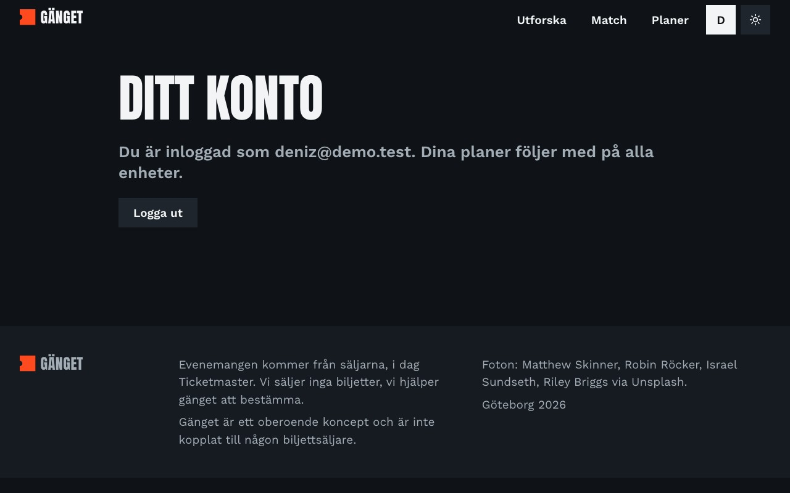
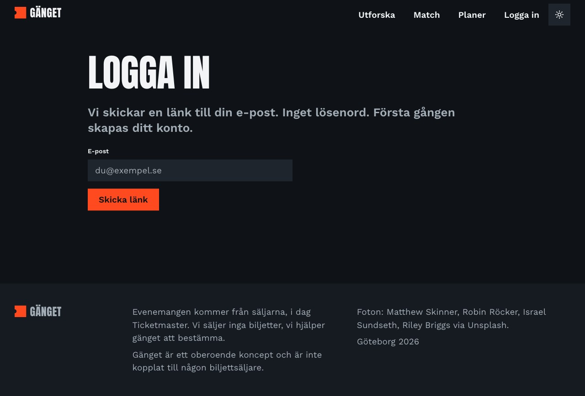
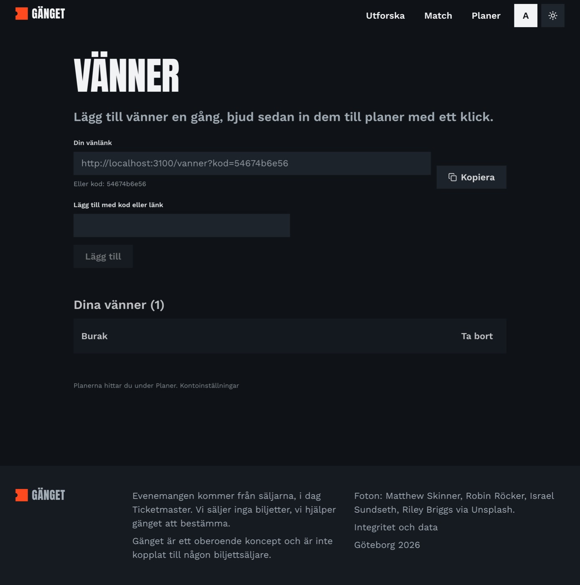

# Gänget: durum ve sayfa sayfa inceleme

Eralp'in incelemesi için Türkçe yazıldı (repo dokümanlarının geri kalanı İngilizce). Güncelleme: 2026-10-18, ikinci tur. Branch: `feat/design-system` (PR1 `feat/backend-foundation` üzerine yığılı; ikisi de push'lanmadı).

Ekran görüntüleri gerçek tarayıcıda, gerçek Supabase veritabanı ve gerçek Ticketmaster verisiyle, **arkadaşları olan bir senaryoda** alındı. Test kullanıcıları ve planları silindi.

## 1. Hüküm

Önceki turdaki hüküm "bitmedi, çekirdek döngü çalışıyor ama sosyal katman yok" idi. Bu turda sosyal katmanın büyük kısmı geldi: davetli akışı, zengin plan odası, yorum thread'i + tepkiler, hesap (e-posta ile giriş). **Hâlâ bitmedi**: e-posta ile girişin gerçek kullanıcıya ulaşması için sizin yapacağınız panel ayarları var, arkadaş listesi ve bildirimler yok, İngilizce yok, ikinci etkinlik kaynağı yok. Aşağıda her şey ayrıntılı.

## 2. Ne yapıldı, ne kaldı

| Alan | Durum | Not |
|---|---|---|
| Marka, tasarım sistemi, `/design` galerisi, koyu/açık tema + **tema düğmesi** | ✅ | |
| Ön sayfa | ✅ | Birincil eylem artık **iki tane**: "Hitta kvällen" ve **"Samla gänget"** (plan kur). Ruh hali seçilince buton "Visa dansa-kvällar" olur ve **doğrudan sonuçlara** götürür. |
| Match (3 adım + sonuç) | ⚠️ | Çalışıyor; bütçe adımı fiyat verisi olmadığı için hâlâ anlamsız. |
| Etkinlik sayfası | ✅ | **Fler tillfällen** (aynı gösterinin diğer tarihleri) ve **yorumlar** eklendi. |
| **Davetli akışı** | ✅ | Davetli planın adını, tarihini, kimlerin olduğunu ve **seçenekleri** görür; favorisini seçip adını yazınca katılır ve **oyu atılır**. |
| **Plan odası** | ✅ | Üyeler ve **kimin oy verdiği**, kartlarda "Röstat av …", plan **tarihi**, odadan **etkinlik ekleme**, plan adı/tarihi düzenleme, karar sonrası "Så röstade ni", **gruba kopyalanabilir mesaj**. |
| **Yorumlar** (FB tarzı) | ✅ | Plan ve etkinlik thread'i, **iki seviye cevap**, 5 tepki (ikonlarla), silme (yazar/organizatör), raporlama, hız sınırı, canlı güncelleme. |
| **Giriş / hesap** | ⚠️ | **E-posta + şifre** (e-posta linki bırakıldı). Misafir hesaba yükselince planlar/oylar kalır. Girişi denedim; **sıfırdan kayıt** sahte adreslerle denenemedi. Şifre sıfırlama yok (SMTP gerekir). |
| Gizlilik sayfası (`/integritet`) | ✅ | Ne saklanıyor, Ticketmaster, silme; iletişim adresi hâlâ yer tutucu. |
| Planlar listesi | ✅ | Küçük resim, tarih, kişi sayısı, "Du har röstat / Din röst saknas", oy sayısı. |
| Katalog kalitesi | ✅ | Tekrar eden gösteriler tek kart (`+N datum`), 20 km dışı elendi, açıklamalardan URL temizlendi, uzak tarihler "31 dec" diye yazılır. |
| Arkadaş listesi (`/vanner`) | ✅ | Arkadaş linki/kodu, kodla ekleme, istek kabul/ret, silme, plan odasından **arkadaşı davet etme** (sadece hesaplı kullanıcılar). |
| Bildirimler | ✅ | "Planer" menüsünde rozet (yeni oy/yorum/üye, davet, arkadaş isteği), plan listesinde "Nytt: …" satırı, "Inbjudningar" bölümü. Dakikada bir ve odaya dönünce güncellenir; e-posta/push yok. |
| İngilizce + dil düğmesi | ❌ | Sıranın sonunda. |
| Harici etkinlikler | ⚠️ | Sadece Ticketmaster; Göteborg & Co yok (anahtar yok). Fiyat yok. |
| Güvenlik (RLS, RPC'ler) | ✅ | İki SQL testi geçti (plan kuralları + yorumlar). Anonim giriş açık, CAPTCHA yok. |
| Erişilebilirlik / çeviri / performans denetimi | ⚠️ | Skill lint 0 hata; gerçek klavye/ekran okuyucu denemesi yapılmadı. |

### Sizin yapmanız gerekenler (kodla çözülemez)

1. Supabase paneli → **Authentication → Sign In / Providers → Email → "Confirm email" KAPALI.** Açık kalırsa şifreyle kayıt e-posta göndermeye çalışır ve dışarıdan biri alamaz.
2. Şifre sıfırlama için ileride kendi SMTP'niz gerekecek (`docs/BACKEND.md`).
3. `/integritet` sayfasındaki iletişim adresini siz belirleyin (Ticketmaster kaldırma talepleri için).

## 3. Bu turda bulunan ve düzeltilen hatalar

1. **Yorumlar hiç görünmüyordu** (ilişki belirsizliği; hata sessizce "yorum yok" gibi görünüyordu). Düzeltildi, artık hata olursa kullanıcıya söyleniyor.
2. **Plan listesi boş geliyordu** aynı türden hatayla. Düzeltildi.
3. **"torsdag" yazıyordu, oysa tarih 31 aralık:** 6 günden uzak etkinliklerde artık tarih yazıyor.
4. Lint: tepkilerde emoji vardı (tasarım kuralı yasaklıyor). Sistem ikonlarına çevrildi.
5. Önceki tur: Ä noktaları, plan kartı etiketi, stilsiz 404, tema düğmesi.

Açık kalan küçük şeyler:
- `Skicka`/`Gå med` gibi düğmeler boşken soluk (devre dışı hali). Kullanılabilir ama bozuk gibi durabilir.
- Etkinlik açıklamaları satıcının dilinde (çoğu İngilizce).
- Katalog: Kungsbacka gibi yerler elendi; bu bilinçli (20 km), ama "Göteborg" tanımını sizin onaylamanız gerekir.

## 4. Dürüst değerlendirme (güncel)

**Amacı taşıyor mu?** Daha iyi. Ön sayfada artık "Samla gänget" eylemi var ve plan odası bir grup aracı gibi davranıyor: kim oy verdi, ne zaman, ne konuşuyorlar. Hâlâ eksik: ilk ekran hâlâ keşif ağırlıklı, grup fikrini anlatan bir örnek yok.

**İçerik yeterli mi?** Düşündüğümden iyi çıktı ama hâlâ sınırlı. "Dansa" seçince **gerçek kulüp geceleri** geliyor (Push, BARDOT, Köket yılbaşı geceleri), yani katalogda kulüp var; sadece ilk 90 günün başında değiller. Zayıf yanlar: tek kaynak, fiyat yok, çoğu etkinlik arena konseri.

**Geri dönüş sebebi var mı?** Bir kısmı: yorumlar ve canlı oylama bir grubu plan sürecinde tutar. Eksik: bildirim (oyu kim verdi, plan kapandı), arkadaş listesi ve e-posta ile hesap bağlantısı gerçek kullanıcıya ulaşmadıkça misafirlik riski sürer.

## 5. Sıradaki plan

| Sıra | İş | Durum |
|---|---|---|
| 1 | Davetli akışı, ön sayfada plan eylemi | ✅ |
| 2 | Plan odası zenginliği | ✅ |
| 3 | Hesap | ✅ e-posta + şifre; "Confirm email" ayarı sizde |
| 4 | İçerik kalitesi | ✅ ilk tur; ikinci kaynak ve fiyat dürüstlüğü açık |
| 5 | Yorumlar + bildirimler | ✅ |
| 6 | Arkadaşlar | ✅ |
| 7 | İngilizce + dil düğmesi | ❌ |

## 6. Senaryo

Pazar akşamı, bir arkadaş grubu cuma için plan yapıyor:
- **Elif** (organizatör), **Mert**, **Selin**, **Can** arkadaşları, **Deniz** sonradan link alan davetli.
- **"Fredag kväll"** (fredag 23 oktober): AMON AMARTH, EUROPE, GLAMORAMA; Elif ve Mert Amon Amarth'a, Selin Europe'a oy verdi; yorumlar ve tepkiler var. Deniz linke tıklıyor, favorisini (EUROPE) seçip katılıyor; sonra bir yorum yazıp **odadan** "WINTHER COUNTRY FESTIVAL" ekliyor.
- **"Lördag på Park Lane"**: kapanmış, kazanan GLAMORAMA.
- **"Stand-up och öl"**: 1–1 beraberlik.

## 7. Sayfa sayfa

Masaüstü 1280 px, çoğunda mobil 390 px. Uzun sayfalar tam sayfa.

### 01. Ön sayfa
Masaüstü: 
Mobil: 
Açık tema ilk ekran: 
Ruh hali seçilmiş (buton "Visa dansa-kvällar", yanında **Samla gänget**): 

Elif bir ruh hali seçer, hero'daki etkinlik değişir, tek tuşla o ruh haline uyan üç öneriye gider, ya da "Samla gänget" ile plan kurar. Sorun: sayfa çok uzun (8.500 px masaüstü).

### 02. Match
Adım 1:  mobil: 
Adım 2: 
Adım 3: 

Sorunlar: üç adım ve takvim hızlı karar vaadine ters; bütçe adımı fiyat olmadığı için anlamsız.

### 03. Match sonucu
 mobil: 

Üç öneri, neden eşleştiğini söyler. Aynı gösterinin tekrarları artık tek kart.

### 04. Etkinlik sayfası (yorumlarla)
 mobil: 

Elif "Visa kommentarer" ile herkese açık thread'i açar (hesap gerekir), yorumunu görür. Gösterinin başka tarihleri varsa "Fler tillfällen" listesi çıkar. Mobil görüntü önceki turdan (yorum bölümü yok).

### 05. Yeni plan
 mobil: 

Hâlâ iki alan (ad, senin adın). Tarih odada sonradan eklenir.

### 06. Planlarım (Elif)
 mobil: 

Küçük resim, "fre 23 okt, 5 personer, 4 alternativ", "Du har röstat", "4 röster hittills". Mobil görüntü önceki turdan.

### 07. Plan odası: oylama sürüyor
 mobil: 

Başlık, tarih ("fredag 23 oktober, 5 personer, 1 har inte röstat"), üye çipleri (oy verenin avatarı turuncu), davet linki, kartlar ("Röstat av Elif, Mert"), **Lägg till event**, **Snacka ihop er** thread'i (iki seviye, tepkiler, Svara/Ta bort/Rapportera). Elif'te ayrıca "Ändra namn och datum". Mobil görüntü önceki turdan.

### 08. Plan odası: arkadaş olarak (Deniz katıldıktan sonra)

### 09. Beraberlik

### 10. Karar verilmiş plan
 mobil: 

Kazanan kâğıt bilet, altında "Så röstade ni" (kim neye oy verdi), **Kopiera meddelande till gänget**, yorumlar. Oy kartları artık yok. Mobil önceki turdan.

### 11. Davetli (Deniz, üye değil)
Masaüstü:  Mobil (avgjord plan): 

Plan adı, "Elif har bjudit in dig till fredag 23 oktober. Med: Elif, Mert, Selin, Can.", seçenek kartları (favori seç), ad alanı, **Gå med och rösta**, "Inget konto behövs". Bu tur en çok değişen ekran.

### 12. Planı olmayan kullanıcı

### 13. 404

### 14. Tasarım sistemi
Koyu:  Açık: 

### 15. Hesap (`/konto`)
Giriş yapmış: 
Giriş yapmamış: 

Giriş yapmamışsa "Logga in" + e-posta alanı; misafirse "Spara dina planer"; hesap varsa e-posta ve "Logga ut". Header'da "Logga in" bağlantısı, girişten sonra baş harfin.

### 16. Arkadaşlar (`/vanner`)
İki hesapla uçtan uca denendi (giriş, isim, link, istek, kabul): 

Plan odasında arkadaş listesi "Bjud in vänner" olarak görünür; davet edilen kişi **Planer** sayfasında "Inbjudningar" altında "Gå med / Avböj" görür, menüde rozet çıkar, katılınca rozet kaybolur. Mobilde rozet alt menüdeki "Planer" üstündedir. (Bu ekranların temiz bir görüntüsü alınamadı; animasyon ortasında yakalandı, o yüzden eklenmedi.)

### 17. İngilizce ve dil değiştirici (SV | EN)
Başlıkta (telefonda da) SV | EN düğmesi var; seçili dil dolu görünür. Düğme sayfayı ve `?kod=`/`?event=` gibi parametreleri korur, `NEXT_LOCALE` çerezini yazar. İngilizce adresler `/en/...` (ör. `/en/plan`, `/en/vanner`); İsveççe adresler eskisi gibi. Tarayıcı dilinden otomatik yönlendirme **yok** (D-022).

390px ve masaüstünde iki dilde bakılanlar: ön sayfa, Match (3 adım + sonuç), planlarım, plan odası, `/konto` ve `/vanner` (misafir halleri), 404. Bulunan ve düzeltilen tek görsel sorun: İngilizce "What are we" telefonda iki satıra kırılıyordu; başlık telefonda İngilizce için %12 küçültüldü. Davet bağlantısı artık gönderenin dilini taşır (`/en/plan/<kod>`).

Dikkat: İngilizce metinleri ben yazdım, insan gözüyle okunmadı; `/integritet` yasal bir metin ve mutlaka okunmalı.

## 8. Doğrulanmayan şeyler

- İngilizce **giriş yapılmış** `/konto` ve `/vanner` (arkadaş listesi, istekler): gerçek bir Supabase hesabı gerektiriyor, oluşturulmadı. Anahtarlar tip denetiminden ve sv/en eşitlik testinden geçti.

- Şifreyle **sıfırdan kayıt** (auth sunucusu sahte e-posta alanlarını reddediyor). Giriş, misafir→hesap yükseltmenin kod yolu ve veritabanı kuralları ayrıca test edildi.
- Arkadaş/bildirim ekranlarının klavye-ekran okuyucu denemesi, açık temada `/vanner`.
- **E-postanın gerçekten gelmesi** ve bağlantıyla dönüş (panel ayarları gerekiyor). Misafiri hesaba çevirme akışı kodlandı ama uçtan uca denenmedi.
- Gerçek ikinci cihaz/tarayıcıda canlı güncelleme (aynı tarayıcıda farklı oturumlarla denendi).
- Klavye ve ekran okuyucu ile uçtan uca gezinme.
- Üretim ortamı (Vercel): ortam değişkenleri Vercel'de tanımlı değil.
- Yorum/tepki arayüzü mobilde (sadece masaüstünde gözle bakıldı).
