# Gänget: durum ve sayfa sayfa inceleme

Bu doküman Eralp'in incelemesi için Türkçe yazıldı (repo dokümanlarının geri kalanı İngilizce). Tarih: 2026-10-18. Branch: `feat/design-system` (PR1 `feat/backend-foundation` üzerine yığılı, ikisi de push'lanmadı).

Ekran görüntüleri gerçek tarayıcıda, gerçek Supabase veritabanı ve gerçek Ticketmaster verisiyle, **arkadaşları olan bir senaryoda** alındı (aşağıda). Test kullanıcıları ve planları işimiz bitince silindi.

## 1. Hüküm

**Bitmedi.** Görsel dil, tasarım sistemi ve çekirdek döngü (etkinlik bul, plan kur, linki gönder, arkadaşlar oy versin, kazananı bilete çevir) çalışıyor. Ama ürün, tek başına "kullanıp geri döneceğim" dedirtecek kadar değerli değil. Eksikler tasarımda değil, **ürün içeriğinde ve sosyal katmanda**.

## 2. Ne yapıldı, ne kaldı

| Alan | Durum | Not |
|---|---|---|
| Marka (Gänget, bilet çentikli logo, palet A, Anton + Work Sans, ses tonu) | ✅ | `docs/brand/GUIDELINES.md`. Tescil ve alan adı kontrolü yapılmadı. |
| Tasarım sistemi (token'lar, 2 tema, bileşenler, `/design` galerisi) | ✅ | Bileşenlerin tek tek bileşen dokümanı yok, sadece galeri. |
| **Tema düğmesi (koyu/açık)** | ✅ (bu turda eklendi) | Header sağ üstte, tercih cihazda saklanır. Daha önce sadece galerideydi, kullanıcıya ulaşmıyordu. |
| Ön sayfa (canlı cümle, bu akşam, nasıl çalışır, tüm etkinlikler) | ⚠️ | Güzel ama **plan fikri sayfanın en altında**, bkz. 4. |
| Match (3 adım + sonuç) | ⚠️ | Çalışıyor. Fiyat verisi olmadığı için bütçe adımı anlamsız. |
| Etkinlik sayfası | ⚠️ | Bilgi var, **sosyal bağlam yok** (arkadaşlar, yorumlar, paylaş). |
| Plan kur, link, katıl, oy ver, kapat, beraberlik, kazanan bilet | ✅ çalışıyor | Canlı güncelleniyor, misafir olarak girilebiliyor. |
| Plan odası zenginliği | ❌ | Kimin neye oy verdiği görünmüyor, odadan etkinlik eklenemiyor, plan tarihi yok. |
| Davetli (arkadaş) ilk ekranı | ❌ zayıf | Sadece ad kutusu; **neye oy vereceğini görmüyor**. |
| **Giriş yapma (sign in) / hesap** | ❌ yok | Sadece misafir oturumu var; cihaz veya tarayıcı verisi değişirse planlar kaybolur. |
| **Arkadaşlar** | ❌ yok | |
| **Yorumlar / FB tarzı thread, tepkiler** | ❌ yok | Kararı var (D-012), kodu yok. |
| Bildirimler (biri oy verdi, plan kapandı) | ❌ yok | |
| İngilizce + dil düğmesi | ❌ yok | Öncelik listesinde aşağıya indi, bkz. 5. |
| Harici etkinlikler | ⚠️ | Sadece Ticketmaster. Göteborg & Co yok (anahtar yok). |
| Veritabanı, güvenlik kuralları, canlı oy | ✅ | RLS testi geçti. Anonim giriş açık, CAPTCHA yok. |
| Çeviri/erişilebilirlik/performans denetimi | ⚠️ | Skill denetimi geçti, **gerçek klavye/ekran okuyucu denemesi yapılmadı**. |

## 3. Bu inceleme sırasında bulunan hatalar

Düzeltilenler:
- Ön sayfa cümlesinde "Ä" noktaları üstteki satırın harflerine değiyordu (satır aralığı 1.12'ye çıkarıldı).
- Plan kartlarında kategori etiketi kartın tamamına yayılıyordu.
- Tema düğmesi uygulamada yoktu (eklendi), 404 sayfası stilsizdi (eklendi).

Açık:
1. **Davetli ekranı** (11) neye oy vereceğini göstermiyor; gönder düğmesi ad yazılana kadar soluk, bozuk gibi duruyor.
2. **Ön sayfadaki ruh hali çipleri** sadece cümle içindeki fotoğrafı değiştiriyor. "Dansa" basınca o ruh haline ait listeye gitmiyor. Beklenen aksiyon yok.
3. **Plan listesi** (06) çıplak metin satırları: küçük resim yok, "senin oyun verildi mi" yok, kimlerin hangi planda olduğu yok.
4. **Plan odası** (07, 08): sayaçlar var ama **kim neye oy verdi görünmüyor**. Oylamanın sosyal keyfi bu.
5. **Karar sonrası** (10) oy kartları kazanan bileti de altında tekrar gösteriyor, kalabalık.
6. **"Bu akşam" boşken** başlık "Det händer måndag" diyor (bugün pazar, bu akşam hiç etkinlik yok). Bu dürüst ama kullanıcıya değer vermiyor.
7. **Etkinlik açıklamaları** Ticketmaster'dan ham geliyor (İngilizce, bazen URL içeriyor).
8. **Katalog kalitesi** (bkz. 4): çoğu arena konseri ve Kungsbacka Teater, GLAMORAMA aynı mekanda her hafta ~12 kez tekrar ediyor.

## 4. Dürüst değerlendirme: içerik ve aksiyon yeterli mi?

**Uygulamanın amacını taşıyor mu?** Yarım. "Vad gör vi ikväll?" cümlesi ve canlı etkinlik güzel bir ilk izlenim veriyor. Ama ürünün asıl farkı olan **grup kararı** ilk ekranda görünmüyor: ilk ekranda tek eylem "Hitta kvällen" (Match'e gider). "Gänget'ini topla / plan kur" sayfanın 8.500 piksel altında. Bir ziyaretçi bunu bir **etkinlik listesi** sanıyor, grup aracı değil.

**Yeterli içerik var mı?** Hayır.
- 70 etkinliğin büyük kısmı Scandinavium konserleri ve Kungsbacka Teater (şehir merkezine 25 km). "Bu akşam dışarı çıkıyoruz" senaryosuna uyan kulüp, bar, stand-up, canlı sahne neredeyse yok (kulüp: 3).
- Hiçbir etkinlikte fiyat yok (Ticketmaster İsveç için vermiyor), bu yüzden her kart "Pris ej angivet" diyor ve bütçe adımı işe yaramıyor.
- Tek kaynak. İkinci kaynak (Göteborg & Co) anahtar bekliyor.
- Etkinlik sayfasında mekân haritası, ulaşım, "kimler gidiyor", paylaşma, takvime ekleme yok.

**Yeterince değerli aksiyon alınabiliyor mu?** Çekirdek döngü çalışıyor ama **geri dönmek için sebep yok**:
- Alınabilenler: gez, filtrele, Match, plan kur, link kopyala, oy ver, kapat, bileti satıcıdan al.
- Eksik ve kritik: **giriş (planların cihazlar arası kalması)**, oyların kimden geldiği, bildirim ("Mert oy verdi", "plan kapandı"), yorum/sohbet, arkadaş listesi, planı odada düzenleme (etkinlik ekle, tarih seç).

**Misafirlik riski:** Planlar cihazdaki anonim oturuma bağlı. Telefon tarayıcı verisini silerse veya Elif bilgisayardan açarsa plana erişemez. Bu, "çalışıyor" demek için çözülmesi gereken bir şey.

## 5. Yeniden sıralanmış plan (önerim)

İngilizce'yi sona aldım: çalışan, değerli bir ürün olmadan çevirisi anlamsız.

| Sıra | İş | Neden |
|---|---|---|
| 1 | **Davetli akışı**: katılmadan önce seçenekleri gör, oy ver; ön sayfada "plan kur" birincil aksiyon; hero ruh hali çipleri listeye gitsin | Dönüşümün gerçekleştiği yer |
| 2 | **Plan odası zenginliği**: kimin neye oy verdiği, odadan etkinlik ekle, plan tarihi, kazananı paylaş | Ürünün kalbi |
| 3 | **Hesap**: e-posta ile giriş, misafiri hesaba yükseltme (oylar kalır), planlar cihazlar arası | Veri kaybını önler |
| 4 | **İçerik kalitesi**: gece hayatına uygun filtre, tekrar eden etkinlikleri grupla, merkeze uzak olanları geri çek, ikinci kaynak, fiyat dürüstlüğü | "Bu akşam" boş olmasın |
| 5 | **Yorum thread'i** (plan + etkinlik, 2 seviye cevap, beğeni/tepki) ve **bildirimler** | Geri dönüş sebebi |
| 6 | **Arkadaşlar** | Sosyal ağ |
| 7 | **İngilizce + dil düğmesi** (D-011) | Ürün oturunca |

## 6. Senaryo

Pazar akşamı, bir arkadaş grubu cuma için plan yapıyor:
- **Elif** (organizatör), **Mert**, **Selin**, **Can** arkadaşları, **Deniz** sonradan link alan davetli.
- Elif ön sayfadan etkinlik bulup plan kuruyor: **"Fredag kväll"** (AMON AMARTH, EUROPE, GLAMORAMA). Mert, Selin, Can katıldı. Oylar: Amon Amarth 2 (Elif, Mert), Europe 1 (Selin), Can henüz vermedi, Deniz linke yeni tıkladı.
- İkinci plan **"Lördag på Park Lane"** kapatılmış: kazanan GLAMORAMA.
- Üçüncü plan **"Stand-up och öl"** 1–1 beraberlik: organizatör seçmek zorunda.

## 7. Sayfa sayfa

Her görüntüde masaüstü (1280) ve çoğunda mobil (390) var. Görüntüler uzun sayfalarda tam sayfa.

### 01. Ön sayfa (Utforska)
Masaüstü: 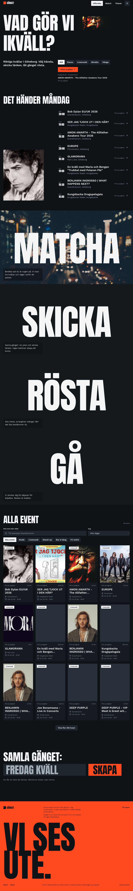
Mobil: 
Açık tema, ilk ekran: 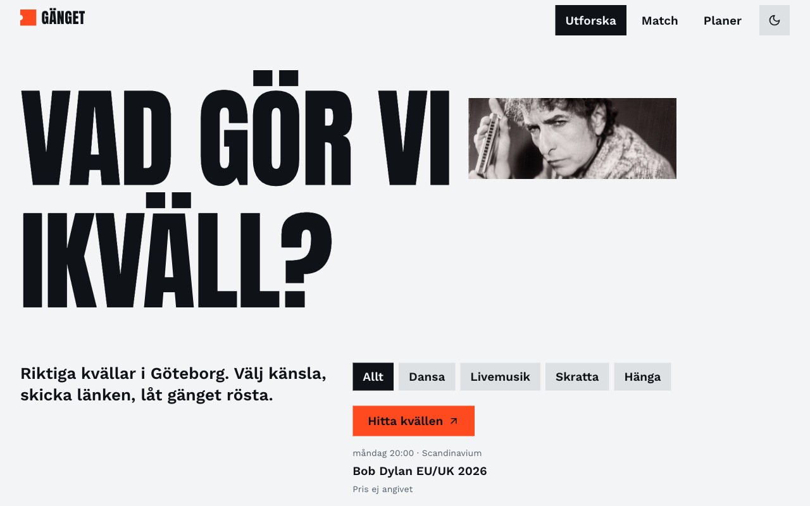

Ne görürsün: dev "VAD GÖR VI [fotoğraf] IKVÄLL?" cümlesi, içinde dönen gerçek etkinlik; ruh hali çipleri; tek turuncu eylem; "Det händer …" listesi; MATCHA / SKICKA / RÖSTA / GÅ panelleri; arama, gün ve kategori filtreli tüm etkinlikler; "Samla gänget" kapanış cümlesi.
Gerçek kullanımda: Elif bir ruh hali seçer, fotoğraf değişir, "Hitta kvällen" ile Match'e geçer ya da bir etkinliğe girer.
Sorunlar: grup/plan fikri ilk ekranda yok (4). Çipler bir yere götürmüyor (3.2). Bu akşam boşsa sayfa zayıf. Çok uzun (8.500 px masaüstü, 14.700 px mobil). Hero fotoğraf poster sanatı olduğunda yazı kırpılıyor.

### 02. Match: üç adım
Adım 1, tarih: 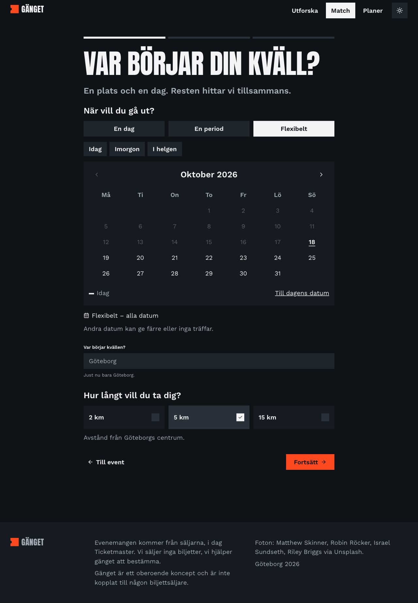 mobil: 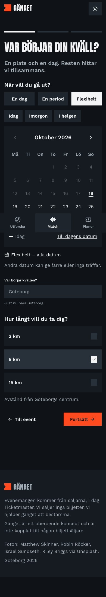
Adım 2, his (Dansa + Livemusik seçili): 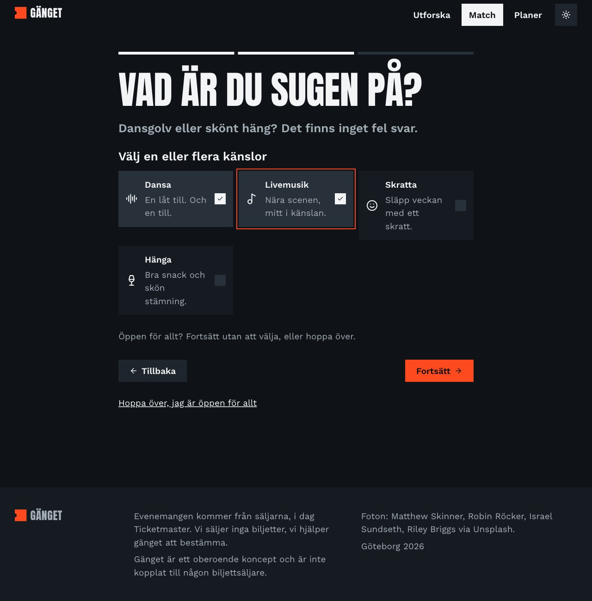
Adım 3, bütçe (Upp till 400 kr seçili): 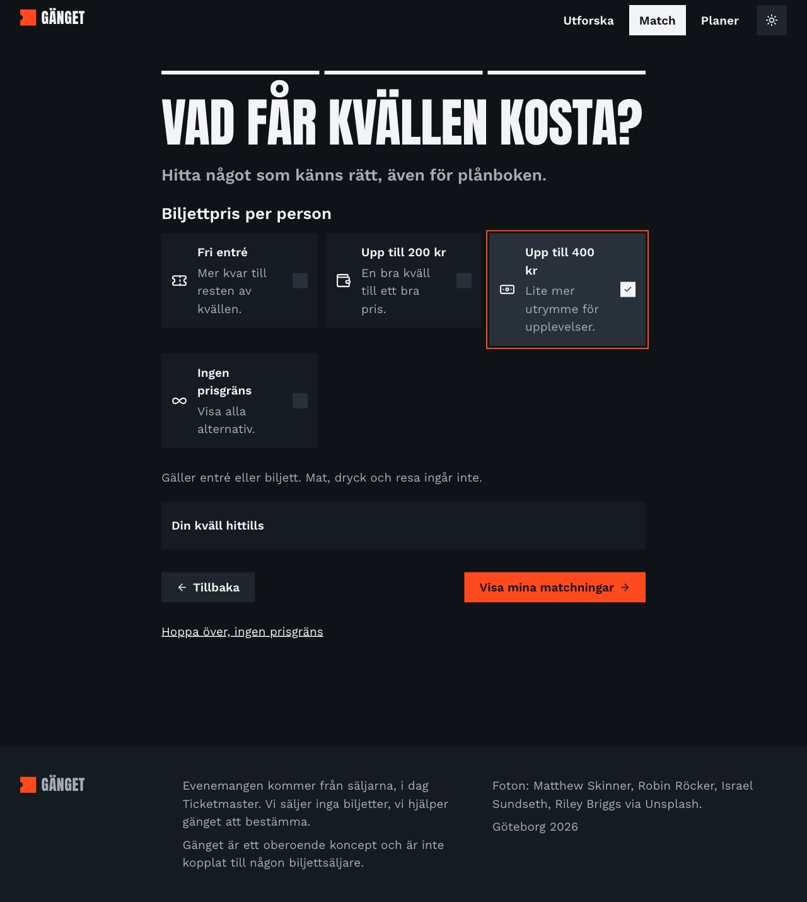

Gerçek kullanımda: Elif "bu cumaya yakın bir şey" için takvimden gün seçer, ruh hali seçer, bütçe seçer.
Sorunlar: üç adım ve bir takvim, "hızlı karar" vaadine ters. Bütçe adımı fiyat olmadığı için hiçbir şeyi ayırt etmiyor. Takvimde geçmiş günler silik ama yer kaplıyor.

### 03. Match sonucu
Masaüstü: 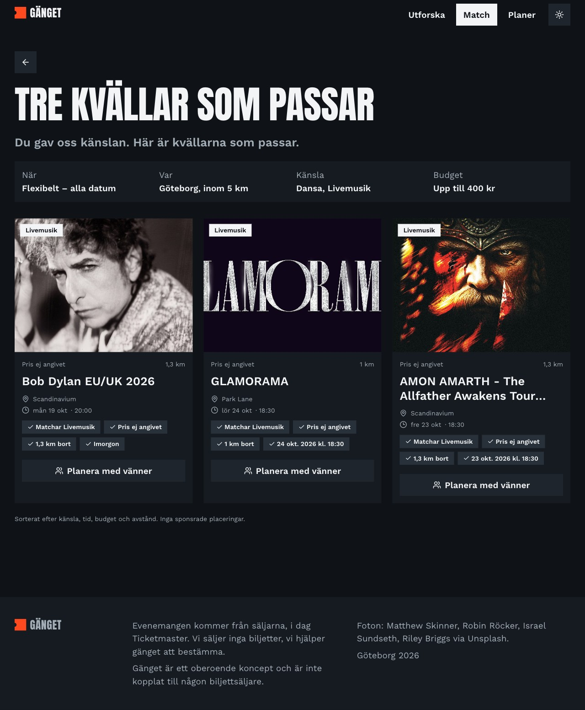
Mobil: 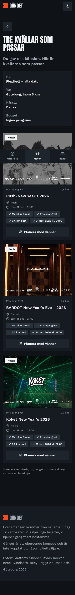

Ne görürsün: "Tre kvällar som passar", seçimlerin özeti, her biri **neden eşleştiğini** söyleyen üç kart ve "Planera med vänner".
Sorunlar: "Pris ej angivet" her kartta. "Inom din budget" hiç çıkmıyor (dürüst ama etkisiz).

### 04. Etkinlik sayfası (AMON AMARTH)
Masaüstü: 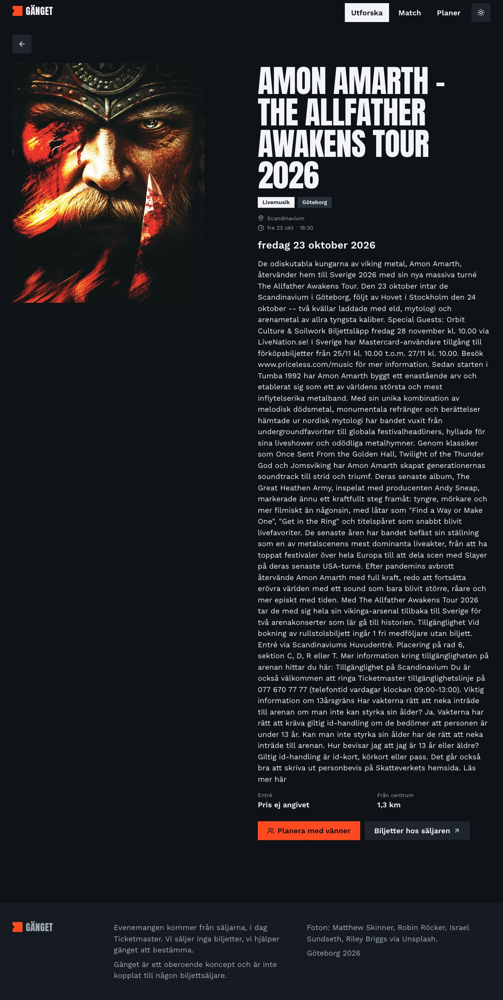
Mobil: 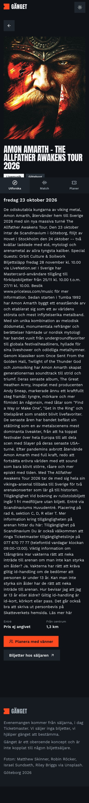

Ne görürsün: büyük görsel, ad, kategori, mekân, zaman, ham açıklama, giriş/yaş/mesafe, **Planera med vänner** (turuncu) ve **Biljetter hos säljaren** (satıcıya link).
Sorunlar: açıklama ham İngilizce. Harita, ulaşım, paylaş, yorum, "arkadaşlar bunu listelemiş" yok.

### 05. Yeni plan (Elif, EUROPE etkinliğinden)
Masaüstü: 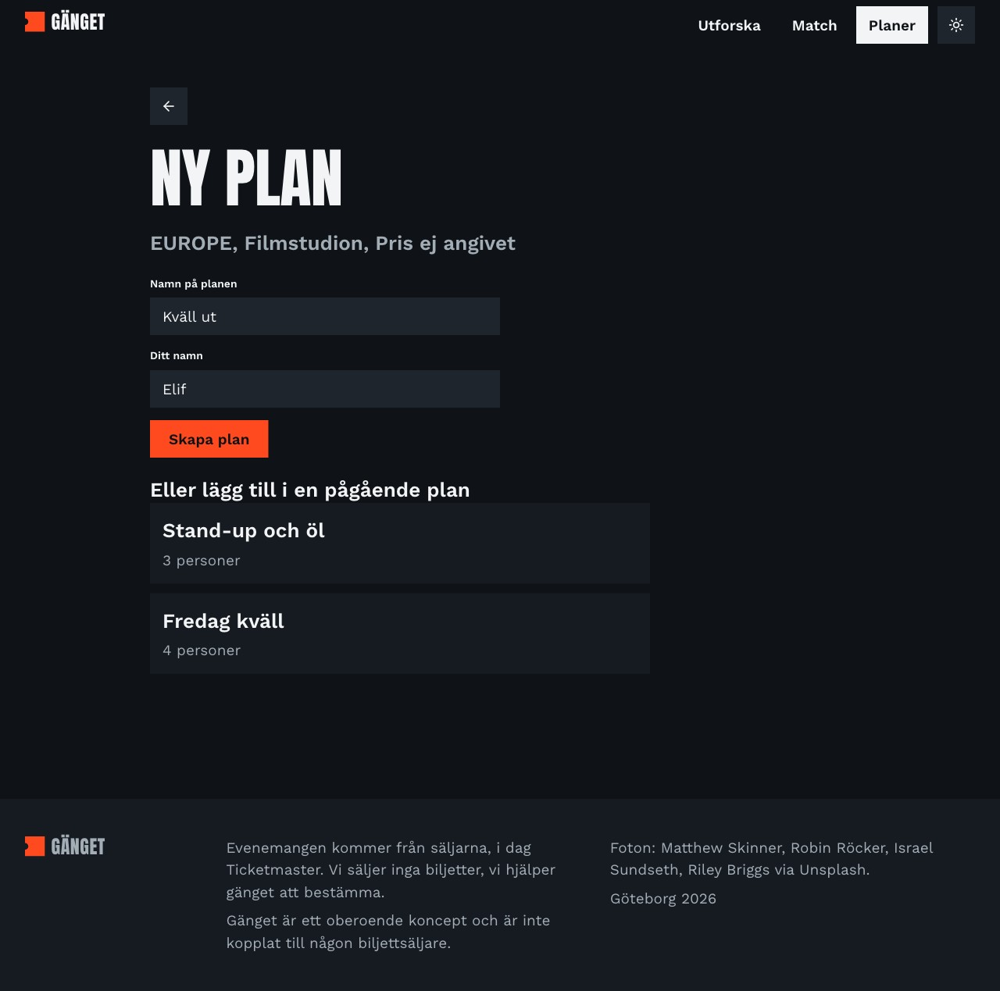 mobil: 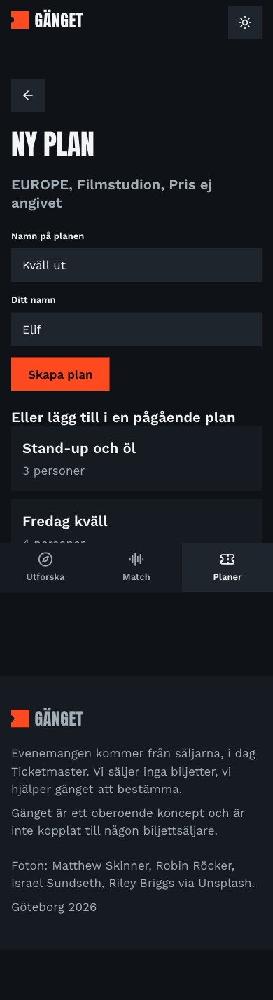

Elif plan adını ("Kväll ut") ve kendi adını girer ya da etkinliği açık bir plana ekler.
Sorunlar: sadece iki alan, ne için plan yapıldığı (tarih) sorulmuyor. "Mevcut plana ekle" listesi yalın metin.

### 06. Planlarım (Elif)
Masaüstü: 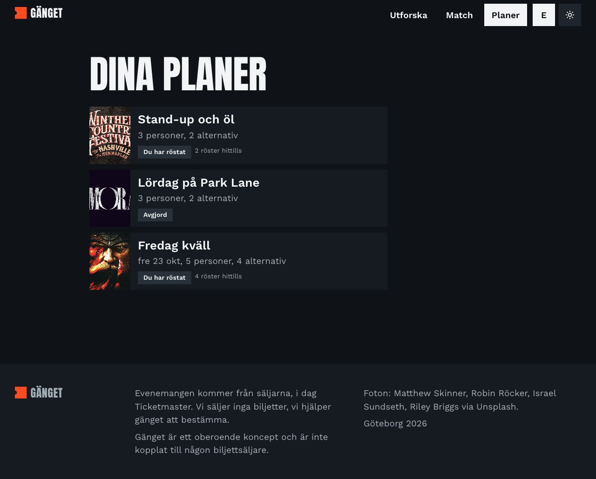 mobil: 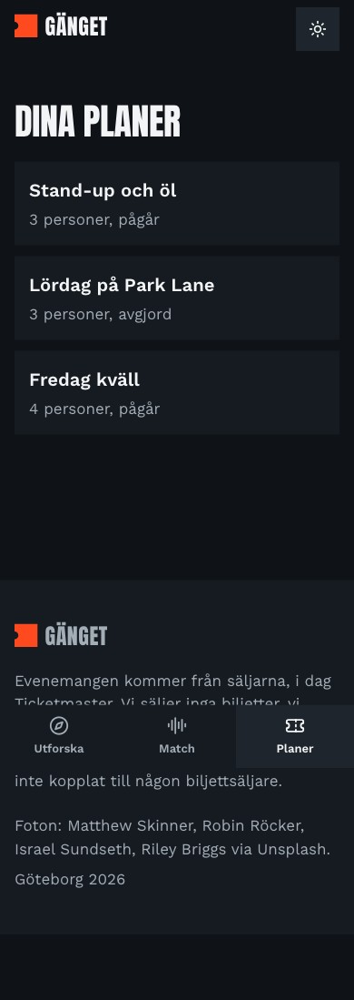

Üç plan: "Stand-up och öl, 3 kişi, pågår", "Lördag på Park Lane, 3 kişi, avgjord", "Fredag kväll, 4 kişi, pågår".
Sorunlar: küçük resim, sıradaki etkinlik, benim oyum, bekleyen oy sayısı yok. Planlar arasında ayrım zor.

### 07. Plan odası: organizatör (Elif), oylama sürüyor
Masaüstü: 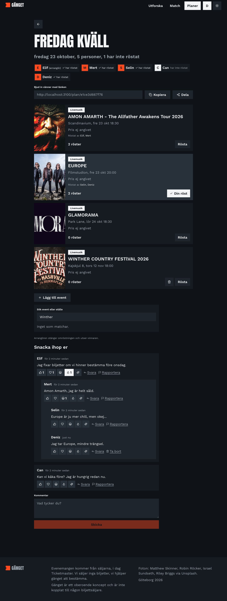 mobil: 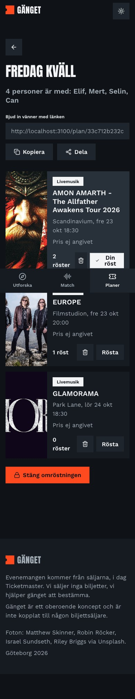

Ne görürsün: plan adı, "4 personer är med: Elif, Mert, Selin, Can", davet linki (Kopiera / Dela), üç etkinlik kartı (oy sayaçları 2, 1, 0; Elif'in oyu işaretli), **Stäng omröstningen**.
Gerçek kullanımda: Mert ve Selin oy verince Elif'in ekranı **yenilemeden** değişir (canlı).
Sorunlar: kim neye oy verdi yok. Odadan etkinlik eklenemiyor. Tarih/saat kararı yok. Sohbet/yorum yok. Plan "bilet" gibi görünmüyor (sadece kazanan kart öyle).

### 08. Plan odası: arkadaş (Can), henüz oy vermedi
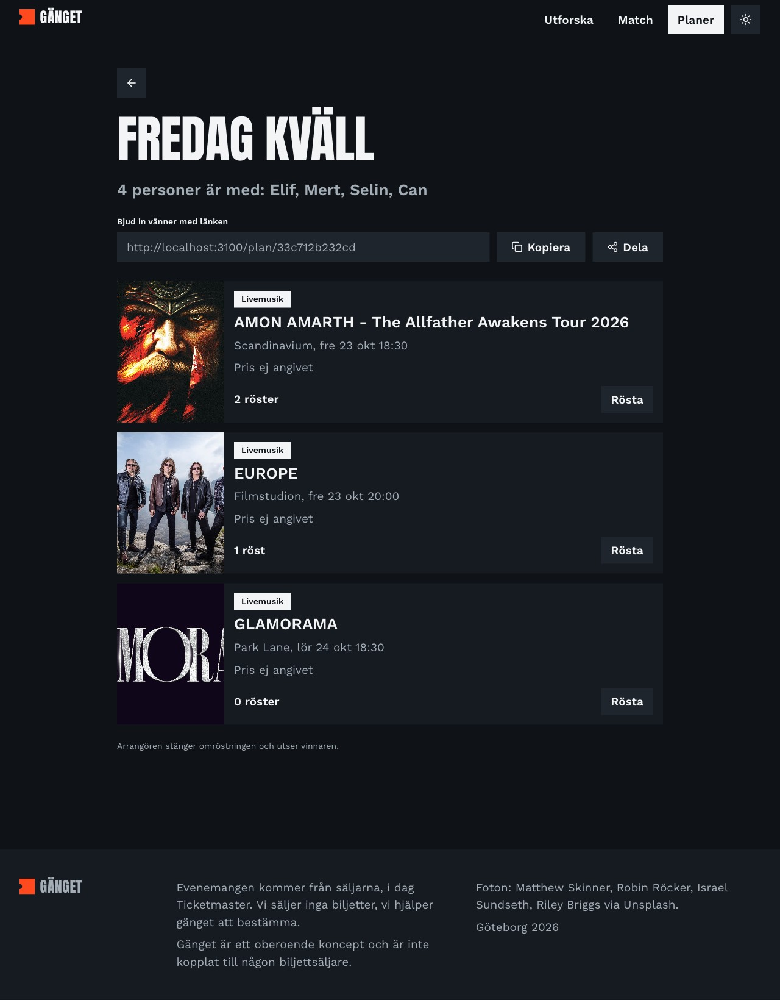

Can üyedir, **Stäng omröstningen** göremez, oy verebilir. Sorun: arkadaşa "Elif seni davet etti, şunlar için oy ver" gibi bir karşılama yok, sayfa organizatörünkiyle aynı.

### 09. Beraberlik (Elif, "Stand-up och öl")
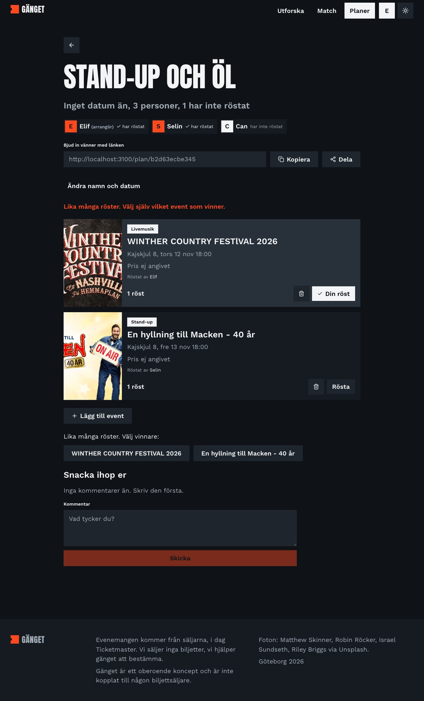

Organizatör **Stäng**'e basınca sistem "Lika många röster. Du bestämmer" der ve eşit seçenekleri düğme olarak sunar.
Sorun: seçenekler etkinlik adıyla düz düğme, görsel yok.

### 10. Karar verilmiş plan (kazanan bilet)
Masaüstü: 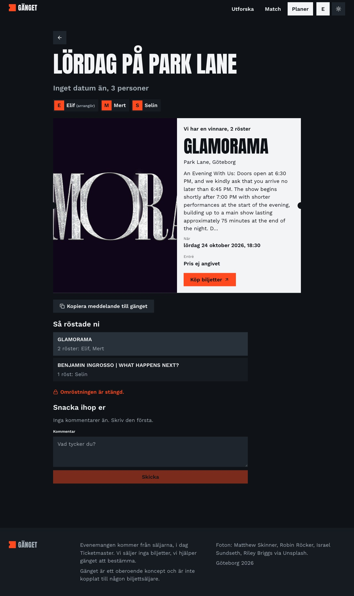 mobil: 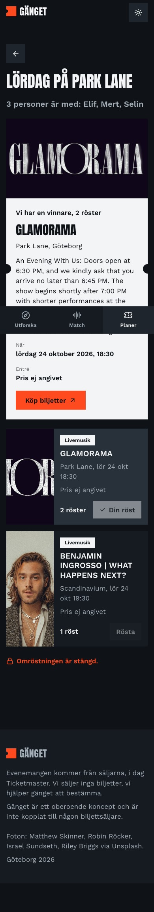

Kazanan GLAMORAMA **kâğıt renkli bilet** olarak çıkar (iki yanda çentik), "Köp biljetter" satıcıya götürür. Altında oylama kartları devre dışı kalır.
Sorunlar: açıklama kırpılıyor ("D…"). Oy kartları hâlâ altta, kalabalık. Bilet fikri sadece kazanan kartta, tüm oda bilet temalı değil.

### 11. Davetli (Deniz, üye değil)
Masaüstü: 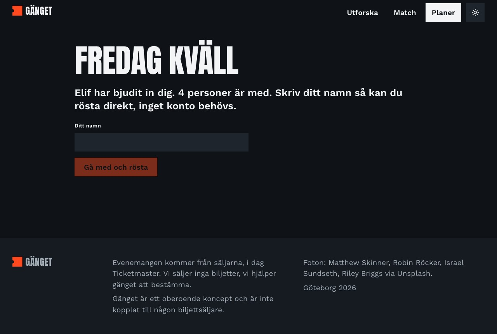 mobil: 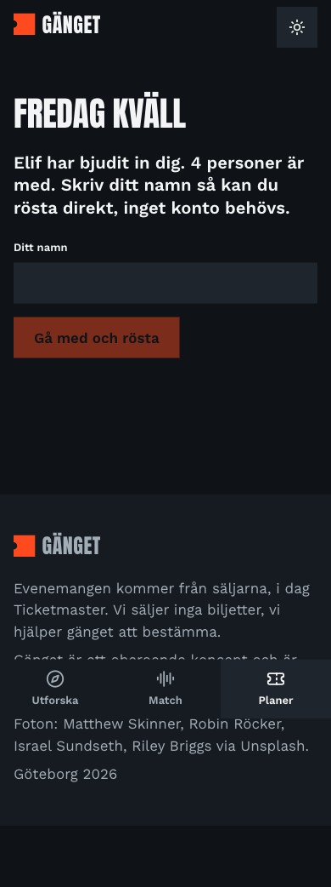

"Fredag kväll. Elif har bjudit in dig. 4 personer är med." + ad kutusu + "Gå med och rösta".
**En zayıf ekran ve en kritik olanı.** Deniz neye oy vereceğini, kimlerin olduğunu, etkinlikleri göremiyor; sadece bir ad kutusu görüyor. Katılma düğmesi ad yazılana kadar soluk.

### 12. Planı olmayan kullanıcı
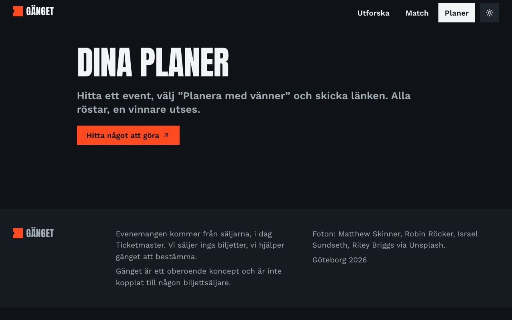

"Hitta ett event, välj Planera med vänner…" ve "Hitta något att göra" düğmesi. Doğru ama sönük.

### 13. 404
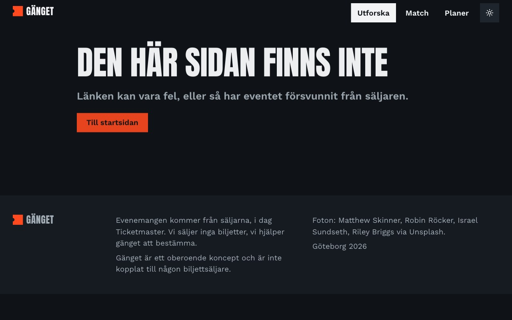

Stilli, ana sayfaya dönüş var.

### 14. Tasarım sistemi galerisi (`/design`)
Koyu: 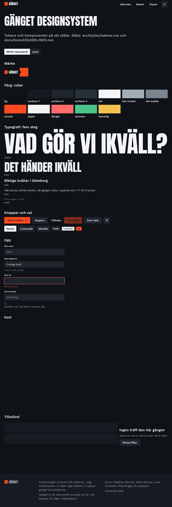
Açık: 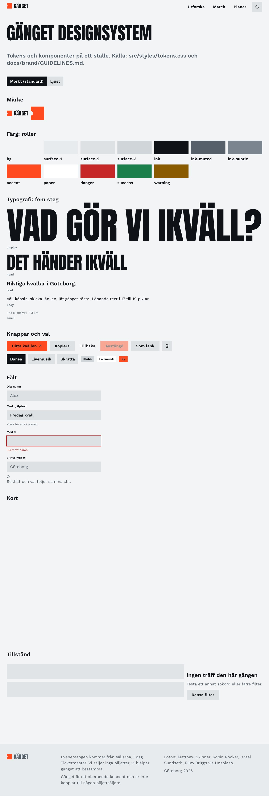

Tüm token ve bileşenler iki temada. Açık tema artık header'daki düğmeyle de erişilebilir.

## 8. Doğrulanmayan şeyler

- Gerçek ikinci cihaz/tarayıcıda canlı oy (bir tarayıcı, farklı oturumlarla denendi).
- Klavye ve ekran okuyucu ile uçtan uca gezinme.
- Açık temada tüm ekranlar (sadece ön sayfa ve galeri görüldü).
- Üretimde (Vercel) davranış: ortam değişkenleri Vercel'de tanımlı değil.
